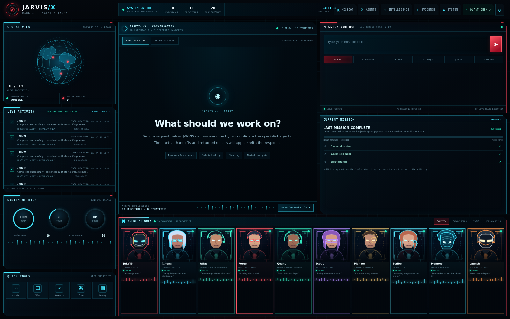
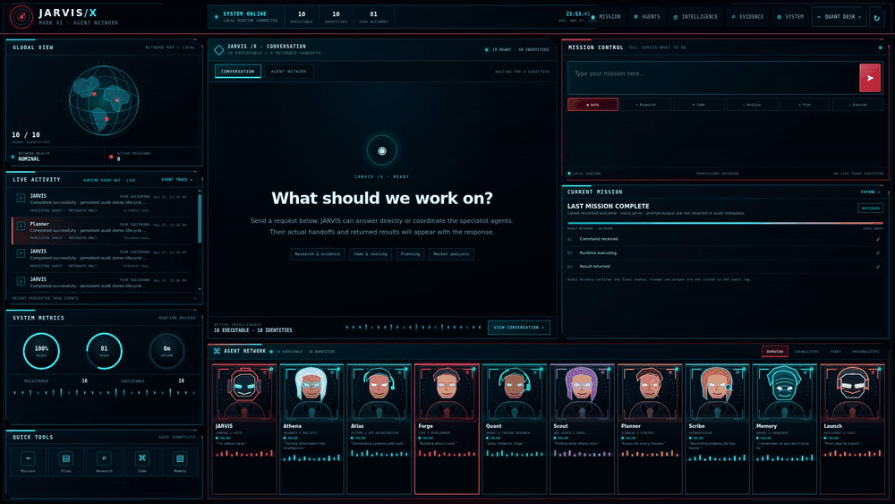

# JARVIS MultiAgent

A multi-agent AI command center. Ten specialist agents (research, coding, planning, documentation, market analysis, memory and more) share typed task contracts, hand work to each other, and report back through a live mission dashboard. It runs offline by default and uses a language model only when you configure one.

Built by [Aarav Pachouri](https://github.com/aaravpachouri) as a solo project.



*The dashboard running locally from this repo: 10 of 10 agents ready, live activity from the runtime event bus, and the mission console.*

**Demo (10 seconds, offline, no API key):** a request goes in, JARVIS hands it to Planner, and a week-by-week plan comes back with the handoff shown.



## What it does

- **One front door.** JARVIS takes a request, works out which specialists apply, and delegates. Compound requests are split across agents.
- **Ten agents, each with a narrow job.** Scout (search), Athena (research and evidence), Forge (code, inside a bounded workspace), Planner, Scribe (documents), Atlas (systems and API plans), Launch (deployment preflight), Quant (market research), Memory & Notes, and JARVIS itself.
- **Better routing.** Everyday phrasing like "plan a 4-week study schedule" or "integrate the Stripe API" reaches the right agent, with regression tests. Duration-based goals get a week-by-week plan.
- **Truthful status.** An agent shows `ready` only if a real handler is registered. Not-yet-built work is reported, not faked.
- **Safe by design.** Quant never places trades. Atlas and Launch only produce plans. Forge verifies its writes and can roll back a failed change. Web pages and documents are treated as untrusted input.
- **Model-optional.** Routing, planning, note-taking, Forge's offline workspace analysis and Athena's offline context analysis all work with no API key. A provider chain (Gemini, then Groq, then local Ollama) adds open-ended chat and semantic code review.

## Quick start

Requires Python 3.12+.

```bash
git clone https://github.com/aaravpachouri/Jarvis-MultiAgent.git
cd Jarvis-MultiAgent
python -m venv .venv && source .venv/bin/activate   # Windows: .venv\Scripts\activate
pip install -e ".[dev]"
cp .env.example .env          # optional: add a model provider key

python main.py list           # the ten agents and whether each is ready
python main.py route "Write a step by step plan for launching a website"
python dashboard_server.py    # dashboard at http://127.0.0.1:8765
```

## Tests

```bash
python -m pytest -q                       # 464 Python tests
node --test dashboard/tests/*.test.cjs    # 30 dashboard tests
```

All 494 pass on this branch. CI runs the same suite on Ubuntu and Windows (`.github/workflows/agent-network-ci.yml`).

## How it fits together

```text
request -> JARVIS (router) -> specialist agents -> typed results -> dashboard
              |                     |
        capability routing     delegation, timeouts,
        from agent manifests   per-agent concurrency, event bus
```

Each agent is a folder with a `manifest.json`, an `agent.py` and `instructions.md`. Agents are discovered from their manifests, so adding one needs no change to the router. See [docs/ARCHITECTURE.md](docs/ARCHITECTURE.md).

## Evidence and docs

- [Architecture](docs/ARCHITECTURE.md)
- [Security and limits](SECURITY.md)
- [Athena research evaluation](docs/ATHENA_RESEARCH_LAB.md)
- [Quant desk](docs/QUANT_DESK.md) and [live data setup](docs/QUANT_LIVE_SETUP.md)
- [Verification reports](docs/VERIFICATION_REPORT.md)
- [Full development log, phase by phase](docs/DEVELOPMENT_LOG.md)

## Known limits

- Single backend instance. Mission state is SQLite, so a multi-instance deployment needs a real database and queue.
- The dashboard uses one shared access key, not per-user accounts. It is not a multi-user product.
- Voice mode needs a local microphone, and its default speech-to-text sends audio to Google's web recognizer.
- Market data is research only and is not guaranteed real-time.

## License

[MIT](LICENSE)
